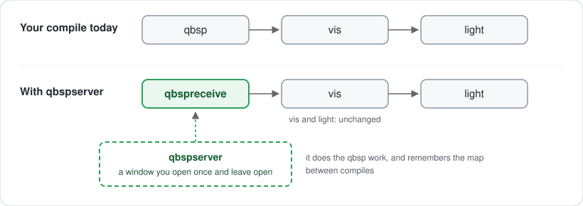

# qbspserver

qbspserver is the `qbsp` from [ericw-tools](https://github.com/ericwa/ericw-tools), changed so that it can stay open while you work on a map. You start it once, and from then on each compile only redoes the parts of the map you changed. `vis` and `light` are not affected.



---

## For mappers

### What changes in the way you work

You probably compile your map with a `.bat` file that runs `qbsp`, `vis` and `light`, or with a compile profile in TrenchBroom. With qbspserver there are two differences:

1. **When you sit down to map, you open qbspserver** on your map. It does a normal compile, then stays open in its own window, waiting.
2. **In your `.bat` or your profile, the `qbsp` line uses `qbspreceive` instead.** `qbspreceive` asks the open qbspserver to compile, and shows the same messages `qbsp` would show.

That's all. `vis`, `light`, your engine and the way you test the map stay as they are.

### What you'll notice

The first compile after opening qbspserver takes the usual time. The compiles after that only redo what you changed, so the `qbsp` step gets much shorter:


How long the `qbsp` step takes, after the first compile:

| What you changed | E1M1 | e3m4 (3,400 brushes) | quakemash (35,000 brushes) |
|---|---|---|---|
| (with plain `qbsp`: anything) | 1.6 s | 8.7 s | 4.5 min |
| moved a light, a monster, an item | 0.1 s | 0.25 s | 2 s |
| changed a texture | 0.2 s | 0.65 s | 5 s |
| moved or added a brush | 0.3 s | 1.3 s | 11 s |

`vis` and `light` take as long as before.

### Download

Get the zip from the [Releases](../../releases) page and unzip it anywhere, for example next to your ericw-tools folder. It has `qbspserver.exe`, `qbspreceive.exe`, a `qbsp.exe` (see [the end of this section](#the-qbspexe-in-the-zip)) and a few DLLs they need.

### If you compile with a .bat file

A typical compile file looks like this:

```bat
C:\tools\ericw-tools\qbsp.exe C:\maps\mymap.map
C:\tools\ericw-tools\vis.exe -fast C:\maps\mymap.bsp
C:\tools\ericw-tools\light.exe C:\maps\mymap.bsp
```

With qbspserver you have **two files**. The first one, `start-server.bat`, opens qbspserver. Double-click it when you start mapping, and leave its window open:

```bat
C:\tools\qbspserver\qbspserver.exe C:\maps\mymap.map
```

The second one is your compile file, with the first line changed:

```bat
C:\tools\qbspserver\qbspreceive.exe C:\maps\mymap.map
C:\tools\ericw-tools\vis.exe -fast C:\maps\mymap.bsp
C:\tools\ericw-tools\light.exe C:\maps\mymap.bsp
```

If you give `qbsp` options (for example `-bsp2`), put them in `start-server.bat`: `qbspserver.exe -bsp2 C:\maps\mymap.map`. `qbspreceive` only needs the map.

### If you compile from TrenchBroom

A common Quake compile profile (**Run → Compile Map…**) has these tasks:

| Task | Tool | Parameters |
|---|---|---|
| Export Map | | `${WORK_DIR_PATH}/${MAP_BASE_NAME}-compile.map` |
| Run Tool | `...\qbsp.exe` | `${MAP_BASE_NAME}-compile.map ${MAP_BASE_NAME}.bsp` |
| Run Tool | `...\vis.exe` | `${MAP_BASE_NAME}.bsp` |
| Run Tool | `...\light.exe` | `${MAP_BASE_NAME}.bsp` |

Make a copy of your profile and change only the `qbsp` task:

| Task | Tool | Parameters |
|---|---|---|
| Run Tool | `...\qbspreceive.exe` | `${MAP_BASE_NAME}-compile.map` |

The `.bsp` name goes to qbspserver instead, when you open it. TrenchBroom can't open qbspserver for you: it would wait for it to finish, and qbspserver stays open on purpose. So:

1. Compile once with your usual profile, so that `mymap-compile.map` exists in your profile's working directory.
2. In that same folder, make a `start-server.bat` with your map's name:
   ```bat
   C:\tools\qbspserver\qbspserver.exe mymap-compile.map mymap.bsp
   ```
3. Double-click it and leave the window open.
4. Compile from TrenchBroom with the new profile, as usual.

### Day to day

- **Open qbspserver when you start mapping, close its window when you're done.** It holds one map. To work on another map, close it and open it on that map.
- **qbspreceive says there's no server.** qbspserver isn't open, or it was closed. Open it again.
- **qbspreceive says the server holds another map.** The map path in your compile file or profile isn't the one qbspserver was opened with.
- **Leaks and errors** show up as with `qbsp`. Fix the map and compile again; qbspserver keeps running.

### Is the map the same?

The map plays the same: the same entities, walls and textures in the same places with the same alignment, and the same collision for the player and monsters. The `.bsp` file isn't identical byte for byte, because qbspserver organizes the map's internal tree a little differently so that it can reuse parts of it. Every version of qbspserver is checked against plain `qbsp` this way, on several maps.

For the version of your map you release, use plain `qbsp` as usual.

### The qbsp.exe in the zip

It's the normal ericw-tools `qbsp`, with speed fixes. Its output is identical, byte for byte, to the one from ericw-tools, and it takes about a third of the time on big maps (quakemash: 4.5 min → 84 s). You can use it instead of your current `qbsp.exe`, with or without qbspserver.

---

## How it works

*From here on, the README is more technical.*

A Quake BSP holds four versions of the map. **Hull 0** is what you see and what `vis` and `light` use. **Hulls 1 and 2** are what players and big monsters collide with: the map inflated by their size. Each hull is a tree that splits space with the brushes' planes. On big maps, building the collision hulls is most of `qbsp`'s time.

qbspserver keeps those trees in memory between compiles and reuses what the edit didn't touch:

| The edit | What qbspserver does |
|---|---|
| nothing | nothing: the `.bsp` on disk is already the result (unless `light`/`vis` changed it since) |
| point entities only (lights, monsters, items), in the same areas | writes the last result again with the new entities, like `qbsp -onlyents`. First it checks that each entity is still in the same area of empty space, because the "outside fill" keeps only the areas that contain entities. If one moved to another area or out of the map, it does a full compile |
| textures, entity keys | reuses hulls 1 and 2 whole, and hull 0's tree if the brushes didn't change; rebuilds hull 0's faces with the new textures |
| brushes | the collision hulls are cut into 1024-unit blocks, and only the blocks the edit touched are rebuilt (usually 1-2 of ~70). When the edit can't reach the void, the outside fill of the previous compile is reused too. Hull 0 is rebuilt as usual: its tree shape matters for `vis` and `light` |

The blocks are why the collision trees differ from plain `qbsp`'s: they're split differently, but what's solid and what's empty is the same.

**How "plays the same" is checked.** Every benchmark run compares qbspserver's BSP with plain `qbsp`'s with `tools/bspcheck.py`:

- the entities;
- every drawn surface (area and position per texture, texture alignment);
- whether ~46,000 points (random, and around every changed face) are solid or empty in each hull.

`tools/sweep.py` does the same on 80 ericw-tools test maps: 79 match, and the 80th is a known `qbsp` bug that qbspserver happens to avoid.

The design, the measurements of each step and what was tried and dropped are in **[qbspserver.md](qbspserver.md)**.

## Command line

```
qbspserver [-port N] [-nohullcache] [qbsp options...] mapname[.map] [output.bsp]
qbspreceive [-port N] mapname[.map]
```

- `qbspserver` takes any `qbsp` option and uses it for every compile.
- `-port N`: run a second qbspserver (another map) on another port, and give `qbspreceive` the same `-port`. The default is 26600. qbspserver only accepts connections from the same computer (`127.0.0.1`).
- `-nohullcache`: rebuild everything on every compile (to compare).
- `qbspreceive` exit codes: `0` compiled, `1` the compile failed, `2` no qbspserver running, `3` qbspserver holds another map.

## Building from source

Requirements (Windows):

- **Visual Studio 2022 or newer**, or just its Build Tools, with the *Desktop development with C++* workload.
- **CMake** 3.14 or newer on the `PATH` (the [cmake.org](https://cmake.org/download/) installer can add it).
- **Git**, and **Python 3** for the test tools.
- Optional: the Vulkan SDK, only for the GPU backend of `light`.

```bat
git clone https://github.com/teiman/qbspserver.git
cd qbspserver
build.bat qbspserver
build.bat qbspreceive
build.bat qbsp
```

`build.bat` downloads Embree and oneTBB into `ericw-tools\deps` the first time and configures CMake in `ericw-tools\build-windows`. Without arguments it builds everything (`light`, `vis`, ...). The programs end up in `ericw-tools\build-windows\qbspserver\Release\` and `ericw-tools\build-windows\qbsp\Release\`.

`dist.bat` packages them into `dist\qbspserver-<version>-win64.zip` with the runtime DLLs, `dist_readme.txt` and the licenses.

On Linux, `build.sh` builds the ericw-tools tree; qbspserver isn't tested there.

### Trying it on E1M1

The scripts in the repository default to `testmap\e1m1.map`. Its textures aren't in the repository: take them once from your own Quake.

```bat
python tools\wadfrombsp.py C:\quake\id1\pak0.pak:maps/e1m1.bsp testmap\gfx\base.wad
build.bat vis
build.bat light
server.bat      &rem leave it open
receive.bat     &rem after each edit of testmap\e1m1.map
play.bat        &rem vis + light, copy to the game folder, start ironwail
```

`play.bat` looks for Quake in `D:\quake`; `set QUAKE=C:\quake` for another folder.

## Measuring

`bench.bat "what changed"` runs the benchmark: 9 kinds of edit (none, entity, texture, move, big move, alignment, add, a few of each, many) on E1M1 and e3m4, 3 times each. Each compile is paired with a plain `qbsp` run and checked with `bspcheck`. Every run is logged in `testmap/bench_history.txt` (one line per version) and `testmap/bench_details.txt` (per-phase times, checks).

```bat
bench.bat "my change"          &rem ~15 min, logged
bench.bat "my change" quick    &rem ~1 min, not logged
python tools\bench.py --help   &rem other maps (quakemash), scenarios, repetitions
```

| Tool | What it does |
|---|---|
| `tools/bench.py` | the benchmark |
| `tools/bspcheck.py` | do two BSPs play the same? |
| `tools/sweep.py` | qbspserver vs plain `qbsp` on 80 ericw-tools test maps |
| `tools/mapedit.py` | the benchmark's edits |
| `tools/wadfrombsp.py` | a wad with the textures of a BSP (or of a BSP inside a `.pak`) |
| `tools/makewad.py` | a placeholder wad for a map whose textures you don't have |
| `tools/autodetail.py` | experiment: thin/small world brushes as `func_detail` (no gain, see `qbspserver.md`) |

Environment variables for debugging and measuring:

| Variable | Effect |
|---|---|
| `ERICW_BENCH=1` | time per phase at the end of each compile, with the cores each phase used |
| `ERICW_SAMPLE=1` | built-in sampling profiler: hottest functions, lines and callers (needs a build with debug info, see `qbspserver.md`) |
| `QBSP_PROFILE_BSP=1` | where `BrushBSP` spends its time |
| `QBSPSERVER_NO_ENTITIES_ONLY=1` | no shortcut for entity-only edits |
| `QBSPSERVER_CHECK_FILL=1` | computes the stored outside fill and the real one, and compares them leaf by leaf |
| `QBSPSERVER_DEBUG_CELLS=1` | logs every rebuilt block of the collision hulls |
| `QBSPSERVER_CHOP_HULLS=1` | chops the world's collision brushes like plain `qbsp` |
| `QBSPSERVER_FAKE_CLIPNODE_LIMIT=N` | pretends the BSP format holds N clipnodes (tests the fallback for maps near the limit) |

## Project layout

| Path | Content |
|---|---|
| `ericw-tools/` | the ericw-tools source tree, with the changes. New: `qbspserver/` (server, client, socket), `qbsp/hullcache.cc` (everything qbspserver reuses), `common/sampler.cc` (profiler) |
| `testmap/` | test maps (`e1m1.map`, `small.map` (also E1M1), `e3m4.map`, `quakemash.map`, `gridtest.map`) and the benchmark history |
| `tools/` | the Python tools above |
| `docs/img/` | the drawings in this README |
| `qbspserver.md` | design, every optimization with its measurements, what was tried and dropped |
| `*.bat` | `build`, `server`, `receive`, `play`, `bench`, `dist` |

## License and credits

Built on **[ericw-tools](https://github.com/ericwa/ericw-tools)** by Eric Wasylishen and contributors, GPL v3 (`ericw-tools/gpl_v3.txt`), and so is this project. It uses [oneTBB](https://github.com/uxlfoundation/oneTBB) (Apache 2.0) and [Embree](https://github.com/RenderKit/embree) (Apache 2.0, for `light`).

The test maps come from ericw-tools' test maps (E1M1), [LibreQuake](https://github.com/lavenderdotpet/LibreQuake) (e3m4) and other Quake maps (quakemash).
