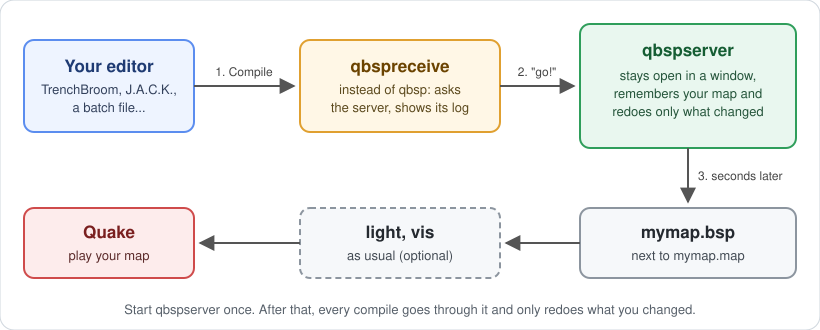
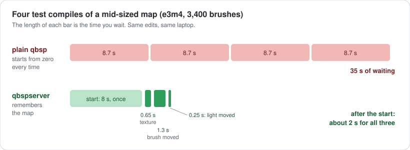

# qbspserver

**Faster test compiles for Quake maps.** You change a texture, move a light or a brush, and you can play the result a moment later instead of waiting for a full compile.

It's built on [ericw-tools](https://github.com/ericwa/ericw-tools), the usual Quake map compilers. It only replaces the `qbsp` step: `light`, `vis` and your engine stay as they are.



---

## For mappers

### What is it?

Every time you compile, `qbsp` starts from zero. It reads the whole map and rebuilds everything, even if you only changed one texture. On a big map that's minutes of waiting, every time you want to see a change.

`qbspserver` is a `qbsp` that **stays open** and **remembers your map**. When you compile again, it works out what your edit touched and redoes only that.

It's two small programs:

- **`qbspserver`**: you start it once and leave its window open while you work. It does the compiling.
- **`qbspreceive`**: you use it where you'd normally use `qbsp`. It tells the server "compile now", waits, and shows you the log, just like `qbsp` would.

### How much faster?



| Your edit | E1M1 | e3m4 (3,400 brushes) | quakemash (35,000 brushes) |
|---|---|---|---|
| plain `qbsp`, any edit | 1.6 s | 8.7 s | 4.5 min |
| nothing changed | instant | instant | instant |
| moved a light / monster / item | 0.1 s | 0.25 s | 2 s |
| changed a texture | 0.2 s | 0.65 s | 5 s |
| moved or added a brush | 0.3 s | 1.3 s | 11 s |
| many edits at once | 0.5 s | 2.7 s | |

*(Intel Core 7 laptop. The first compile after starting the server takes the normal time. "Nothing changed" is instant if the `.bsp` wasn't touched since; after `light` or `vis` it takes about as long as moving a light.)*

### Is the map the same?

It **plays the same**: same entities, same walls and textures where you'd expect them, same texture alignment, same collision for the player and monsters. The file isn't byte-for-byte identical to plain `qbsp`'s, because the server splits the map a bit differently inside so it can reuse parts. Every change to this project is tested against plain `qbsp` on several maps, comparing all of that automatically.

For the **final version you release**, you can compile with plain `qbsp` as usual. A faster `qbsp.exe` comes in the same download (see [Bonus](#bonus-a-faster-qbsp)).

### Getting started

**1. Download.** Get `qbspserver-...-win64.zip` from the [Releases](../../releases) page and unzip it anywhere, for example `C:\quake-tools\qbspserver\`. There's nothing to install.

**2. Start the server** for the map you're working on. It needs the full path to your `.map` file. The easiest way is a small text file next to the programs called `start-server.bat`:

```bat
@echo off
"C:\quake-tools\qbspserver\qbspserver.exe" -bsp2 "C:\maps\mymap.map"
pause
```

Double-click it. A window opens, compiles the map once (normal speed) and then says it's waiting:

```
qbspserver: first compile done (0)
qbspserver: holding C:\maps\mymap.map
qbspserver: listening on 127.0.0.1:26600, waiting for qbspreceive
```

**Leave that window open** while you work. To stop it, close the window or press Ctrl+C in it.

> `-bsp2` is a normal `qbsp` option (a map format that allows big maps). Put here the same options you give `qbsp` today. If you don't use any, you can leave it out.

**3. Compile through the server.** Save your map in the editor, then run `qbspreceive` with the **same map path**:

```bat
"C:\quake-tools\qbspserver\qbspreceive.exe" "C:\maps\mymap.map"
```

It writes `mymap.bsp` next to `mymap.map`, exactly where `qbsp` would. Set up your editor to do this for you; see below.

**4. Light, vis, play** as you always do. Nothing changes there.

### Setting up TrenchBroom

In **Run → Compile Map…**, make a copy of your compile profile and replace the `qbsp` step:

| Task | Tool | Parameters |
|---|---|---|
| Run Tool | `C:\quake-tools\qbspserver\qbspreceive.exe` | `"${MAP_DIR_PATH}/${MAP_BASE_NAME}.map"` |
| Run Tool | `light.exe` (as before) | as before, on `${MAP_BASE_NAME}.bsp` |
| Run Tool | `vis.exe` (as before, optional) | as before |
| Copy Files | as before | as before |

Things to keep in mind:

- **Save your map before compiling** (Ctrl+S). The server compiles the `.map` file on disk, so it only sees what you've saved.
- In this profile, `qbspreceive` works on your saved `.map` directly. If your profile has an **Export Map** task, remove it: the server must always compile the same file.
- Start `qbspserver` on that same `.map` before you compile for the first time.

### Other editors and batch files

Wherever you used to call `qbsp mymap.map`, call `qbspreceive mymap.map` instead, with the server already running on that map. For example:

```bat
@echo off
set TOOLS=C:\quake-tools
"%TOOLS%\qbspserver\qbspreceive.exe" "C:\maps\mymap.map" || goto failed
"%TOOLS%\ericw-tools\light.exe" "C:\maps\mymap.bsp"
copy /y "C:\maps\mymap.bsp" "C:\quake\id1\maps\" >nul
echo Done.
exit /b 0
:failed
echo Compile failed, see above.
pause
```

### Questions and problems

**`qbspreceive` says there's no server running (exit code 2).**
Start `qbspserver` first (step 2), and leave its window open.

**It says the server holds another map (exit code 3).**
A server works on one map. Close it and start it again with the new map. To work on two maps at once, start a second server with another port: `qbspserver -port 26601 ...` and `qbspreceive -port 26601 ...`.

**The first compile is as slow as usual.**
That's expected: the server builds everything once so it can reuse it later. The compiles after that are the fast ones.

**My map leaks / has errors.**
The server reports leaks and errors exactly like `qbsp`, and `qbspreceive` shows them. Fix the map, save, and compile again. The server keeps running.

**I edited textures in my wad.**
That's fine: the server notices that the wad changed.

**Does it work with my engine (Quakespasm, ironwail, vkQuake…)?**
Yes. The result is an ordinary BSP file, the same format `qbsp` writes with the same options.

**Windows only?**
The download is for Windows (64-bit). The code is portable and has a Linux build script, but that isn't tested.

### Bonus: a faster qbsp

The download includes `qbsp.exe`, the normal ericw-tools compiler with speed fixes. Its output is **identical, byte for byte**, to the original's, and it's about **3× faster** on big maps (quakemash: 4.5 min → 84 s). You can use it as a drop-in replacement for your current `qbsp.exe`, with or without the server.

---

## How it works (a bit more technical)

A Quake BSP holds four versions of the map. **Hull 0** is what you see: walls, textures, and what `vis` uses. **Hulls 1 and 2** are what players and big monsters collide with: the map "inflated" by their size. On a big map, building the collision hulls is most of `qbsp`'s time. Each hull is a tree that splits space with the brushes' planes.

`qbspserver` keeps all that in memory between compiles and reuses as much as it can:

| You changed… | What the server does |
|---|---|
| nothing | answers at once: the `.bsp` on disk is already the result |
| point entities only (lights, monsters, items), still in the same rooms | writes the last result again with the new entities, like `qbsp -onlyents`, but first checks it's safe. A moved entity can change which areas get filled as "outside", so if any entity is now in another area (or outside the map), it does a full compile |
| textures, entity keys | reuses hulls 1 and 2 whole; hull 0's tree too, if the brushes didn't move; rebuilds the faces with the new textures |
| brushes | the collision hulls are cut into 1024-unit blocks, and only the blocks you touched are rebuilt (usually 1-2 of ~70). When the edit can't reach the void, the server also skips the "outside fill" that finds and removes the void, and applies the previous one. Hull 0 is rebuilt as usual (its tree shape matters for `vis` and `light`) |

The server's collision trees are split a bit differently from plain `qbsp`'s, because of the blocks. That's why the file isn't byte-identical. What's solid and what's empty is the same.

**"Plays the same" is measured.** Every benchmark run compares the server's BSP with plain `qbsp`'s, using `tools/bspcheck.py`:

- the entities;
- every drawn surface (area and position per texture, and texture alignment);
- whether ~46,000 random points, plus points around every changed face, are solid or empty in each hull.

On top of that, `tools/sweep.py` compiles 80 ericw-tools test maps both ways. 79 match. The 80th is a known `qbsp` bug that the server happens to avoid.

The full design, the measurements of every step and what was tried and dropped are in **[qbspserver.md](qbspserver.md)**.

## Building from source

Requirements (Windows):

- **Visual Studio 2022 or newer**, or just the Build Tools, with the *Desktop development with C++* workload.
- **CMake** 3.14 or newer on the `PATH` (the [cmake.org](https://cmake.org/download/) installer can add it).
- **Git**, and **Python 3** for the test tools.
- Optional: the Vulkan SDK, only for the GPU backend of `light`.

```bat
git clone https://github.com/teiman/qbspserver.git
cd qbspserver
build.bat qbspserver
build.bat qbspreceive
build.bat qbsp
```

`build.bat` downloads Embree and oneTBB into `ericw-tools\deps` the first time, and configures CMake in `ericw-tools\build-windows`. Without arguments it builds everything (`light`, `vis`, …). The programs end up in:

- `ericw-tools\build-windows\qbspserver\Release\` (`qbspserver.exe`, `qbspreceive.exe`)
- `ericw-tools\build-windows\qbsp\Release\` (`qbsp.exe`)

`dist.bat` packages them into `dist\qbspserver-<version>-win64.zip` with the runtime DLLs, `dist_readme.txt` and the licenses.

On Linux, `build.sh` builds the ericw-tools tree (untested for qbspserver).

### Trying it on E1M1

The repository's scripts default to `testmap\e1m1.map`. Its textures aren't in the repository: take them once from your own Quake:

```bat
python tools\wadfrombsp.py C:\quake\id1\pak0.pak:maps/e1m1.bsp testmap\gfx\base.wad
build.bat vis
build.bat light
server.bat      &rem leave it open
receive.bat     &rem after each edit of testmap\e1m1.map
play.bat        &rem vis + light, copy to C:\quake\qbspserver\maps, start ironwail
```

`play.bat` assumes Quake in `D:\quake`. Set `QUAKE=C:\quake` for another folder.

## Command line

```
qbspserver [-port N] [-nohullcache] [qbsp options...] mapname[.map]
qbspreceive [-port N] mapname[.map]
```

- `qbspserver` takes any `qbsp` option and uses it for every compile. It listens on `127.0.0.1` only (port 26600 by default), so nothing outside your computer can reach it.
- `-nohullcache` rebuilds everything every time (to compare).
- `qbspreceive` exit codes: `0` compiled, `1` the compile failed, `2` no server running, `3` the server holds another map.

### Environment variables (debugging and measuring)

| Variable | Effect |
|---|---|
| `ERICW_BENCH=1` | time per phase at the end of each compile, with the cores each phase used |
| `ERICW_SAMPLE=1` | built-in sampling profiler: hottest functions, lines and callers (needs a build with debug info, see `qbspserver.md`) |
| `QBSP_PROFILE_BSP=1` | where `BrushBSP` spends its time |
| `QBSPSERVER_NO_ENTITIES_ONLY=1` | no shortcut for entity-only edits |
| `QBSPSERVER_CHECK_FILL=1` | computes the stored fill and the real one, and compares them leaf by leaf |
| `QBSPSERVER_DEBUG_CELLS=1` | logs every rebuilt block of the collision hulls |
| `QBSPSERVER_CHOP_HULLS=1` | chops the world's collision brushes like plain `qbsp` |
| `QBSPSERVER_FAKE_CLIPNODE_LIMIT=N` | pretends the BSP format holds N clipnodes (tests the fallback for maps near the limit) |

## Measuring

`bench.bat "what changed"` runs the benchmark: 9 kinds of edit (none, entity, texture, move, big move, alignment, add, a few of each, many) on E1M1 and e3m4, 3 times each. Each server compile is paired with a plain `qbsp` run and checked with `bspcheck`. Every run is logged in `testmap/bench_history.txt` (one line per version) and `testmap/bench_details.txt` (per-phase times, checks), so each change is measured against the previous one.

```bat
bench.bat "my change"          &rem ~15 min, logged
bench.bat "my change" quick    &rem ~1 min, not logged
python tools\bench.py --help   &rem other maps (quakemash), scenarios, repetitions
```

| Tool | What it does |
|---|---|
| `tools/bench.py` | the benchmark |
| `tools/bspcheck.py` | do two BSPs play the same? |
| `tools/sweep.py` | server vs plain `qbsp` on 80 ericw-tools test maps |
| `tools/mapedit.py` | the benchmark's edits (scenarios) |
| `tools/wadfrombsp.py` | a wad with the textures of a BSP (or a BSP inside a `.pak`) |
| `tools/makewad.py` | a placeholder wad for a map whose textures you don't have |
| `tools/autodetail.py` | experiment: compile thin/small world brushes as `func_detail` (no gain, see `qbspserver.md`) |

## Project layout

| Path | Content |
|---|---|
| `ericw-tools/` | the ericw-tools source tree, with the changes. New: `qbspserver/` (server, client, socket), `qbsp/hullcache.cc` (everything the server reuses), `common/sampler.cc` (profiler) |
| `testmap/` | test maps (`e1m1.map`, `small.map` (also E1M1), `e3m4.map`, `quakemash.map`, `gridtest.map`) and the benchmark history |
| `tools/` | the Python tools above |
| `docs/img/` | the drawings in this README |
| `qbspserver.md` | design, every optimization with its measurements, what was tried and dropped |
| `*.bat` | `build`, `server`, `receive`, `play`, `bench`, `dist` |

## License and credits

Built on **[ericw-tools](https://github.com/ericwa/ericw-tools)** by Eric Wasylishen and contributors, GPL v3 (`ericw-tools/gpl_v3.txt`), and so is this project. It uses [oneTBB](https://github.com/uxlfoundation/oneTBB) (Apache 2.0) and [Embree](https://github.com/RenderKit/embree) (Apache 2.0, for `light`).

The test maps come from ericw-tools' test maps (E1M1), [LibreQuake](https://github.com/lavenderdotpet/LibreQuake) (e3m4), and other Quake maps (quakemash).
